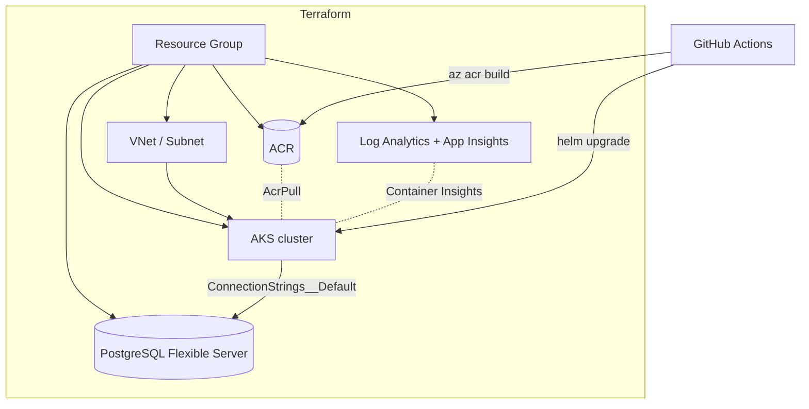

# Azure AKS Platform (Terraform + Helm)

> Production-style **Infrastructure as Code** for running a containerized API on Azure:
> **Terraform** provisions AKS, ACR, PostgreSQL and observability; a **Helm** chart deploys
> the app; **GitHub Actions** validates the IaC and ships images. Deploys the
> [ERP Integration API](https://github.com/kratos0722/erp-integration-service).


> ℹ️ **About this project:** An **independent reference implementation** of a deployment
> approach I used in production (containerized services on **AKS via Terraform/CI-CD**,
> 2020–2024). No proprietary code, state, or secrets are included. `terraform validate`
> and `helm lint` both pass in CI; `plan`/`apply` require your own Azure subscription.

---

## 📌 What it provisions

- **AKS** cluster (system-assigned identity, Azure CNI, Container Insights)
- **ACR** container registry, with an `AcrPull` role assignment so the cluster can pull images
- **PostgreSQL** Flexible Server + database
- **Observability**: Log Analytics workspace + Application Insights
- **VNet/subnet** for the cluster
- A **Helm chart** (Deployment, Service, Ingress, HPA, ConfigMap, Secret) for the API

---

## 🏗 Architecture



The Terraform is **modular** — [`terraform/modules/`](terraform/modules/) holds `network`,
`acr`, `aks`, `postgres` and `observability`, wired together in
[`terraform/main.tf`](terraform/main.tf). Each module is independently reusable.

---

## 🛠 Tech Stack

- **IaC:** Terraform (azurerm ~> 4.0), modular layout, remote-state ready
- **Cloud:** Azure — AKS, ACR, PostgreSQL Flexible Server, Log Analytics, App Insights
- **Deploy:** Helm 3 (autoscaling, ingress, config/secret separation)
- **CI/CD:** GitHub Actions — `terraform fmt/validate` + `helm lint` on every PR; a manual build-and-deploy pipeline (`az acr build` → `helm upgrade`)
- **Containerization:** multi-stage .NET 8 Dockerfile

---

## 🚀 Usage

```bash
# 1) Provision infrastructure
cd terraform
cp terraform.tfvars.example terraform.tfvars   # fill in subscription + a DB password
terraform init
terraform plan      # requires an authenticated Azure session
terraform apply

# 2) Build + push the app image, then deploy
az acr build --registry <acr> --image erp-integration-service:v1 --file docker/Dockerfile <app-repo>
az aks get-credentials --resource-group rg-erpplat-dev --name aks-erpplat-dev
helm upgrade --install erp-api charts/erp-api --set image.tag=v1
```

---

## ✅ Validation (runs in CI, no cloud account needed)

```bash
cd terraform && terraform fmt -check -recursive && terraform init -backend=false && terraform validate
helm lint charts/erp-api && helm template erp charts/erp-api
```

---

## 🔒 Notes on security & cost

- Secrets (DB password, kubeconfig) are **never committed** — `*.tfvars` and kubeconfigs are gitignored; the Helm secret value is a placeholder injected at deploy time (Key Vault / CSI driver in a real setup).
- Sizes default to small/cheap SKUs (`Standard_B2s`, `B_Standard_B1ms`) for a demo; scale via variables.

---

*This repository demonstrates infrastructure and delivery practices only. It contains no
proprietary code, Terraform state, or confidential information from any employer or client.*
